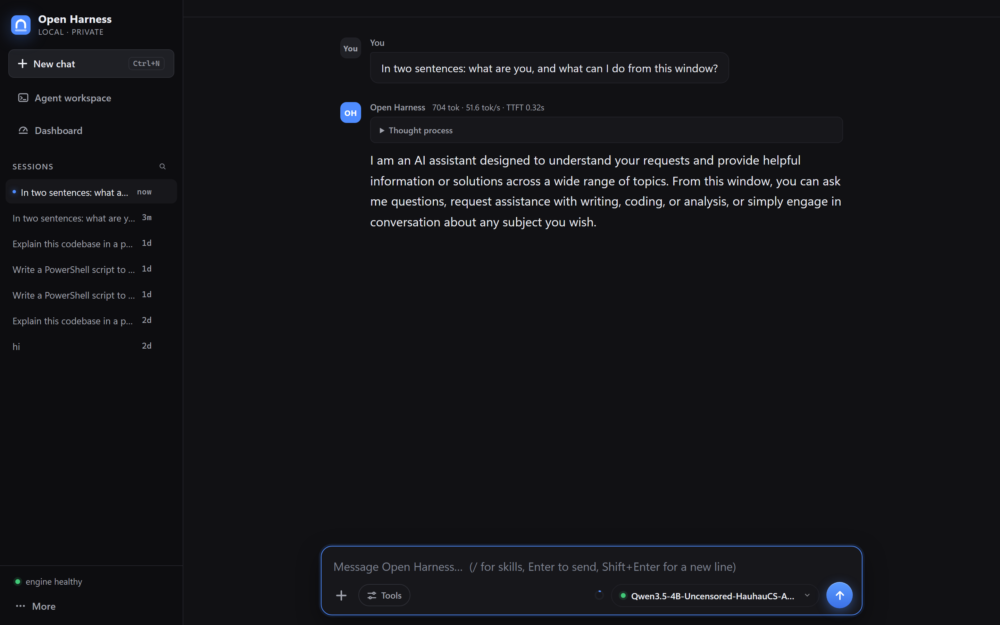
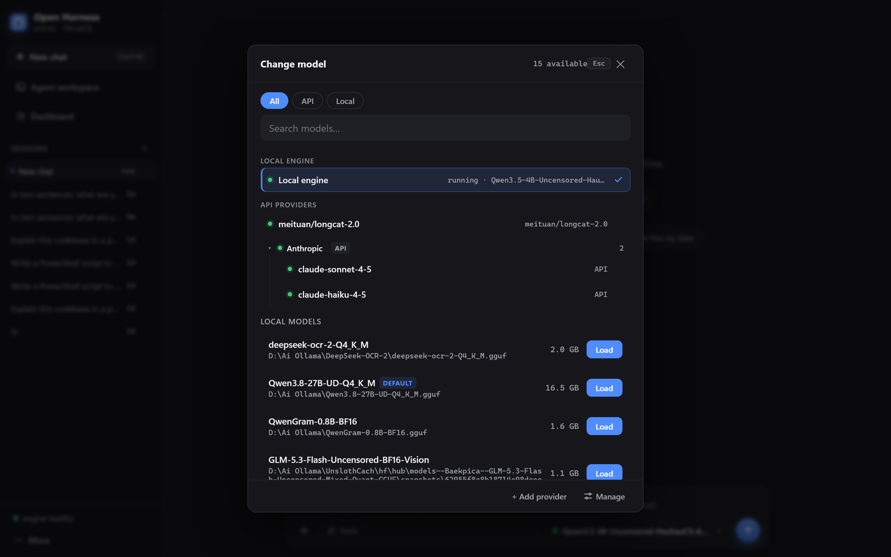
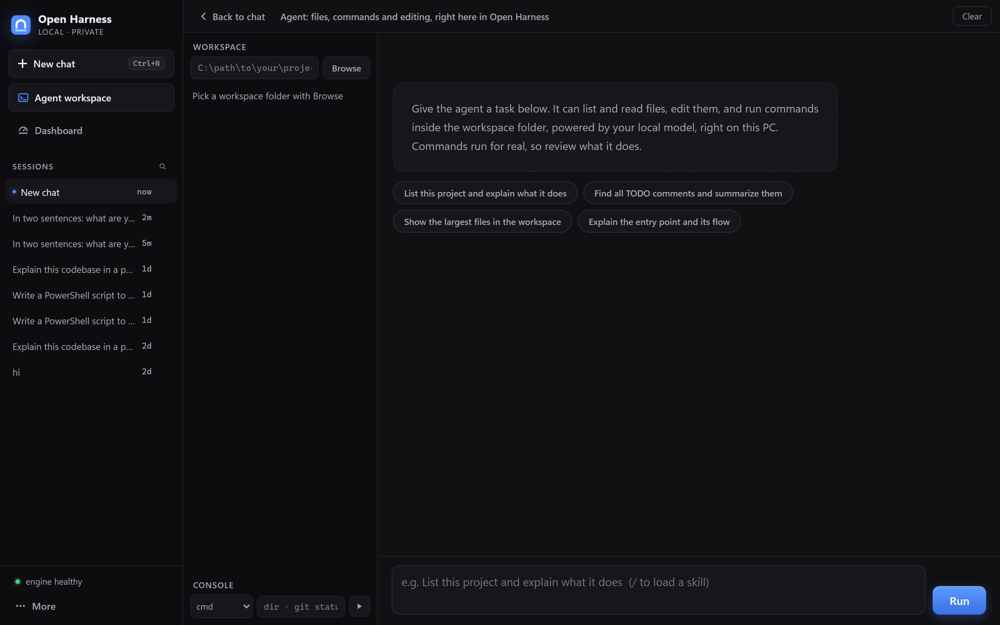
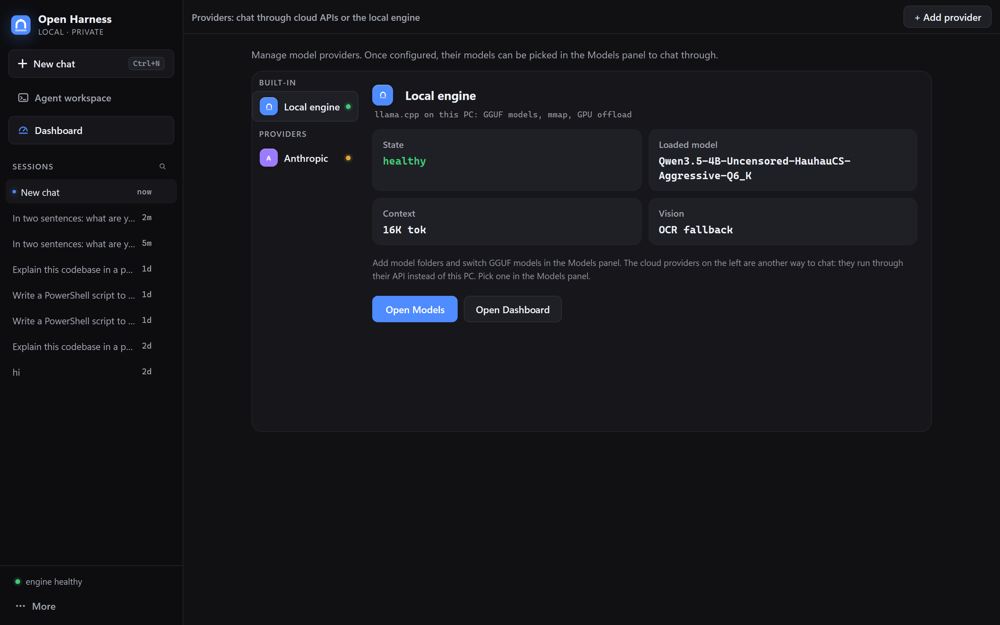
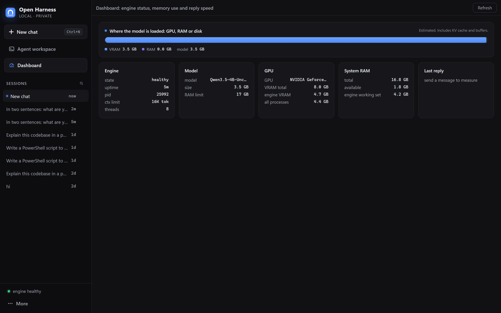

# Open Harness

A fully local AI workspace for Windows. Chat with any GGUF model, run a coding agent on your own files, and keep every byte on your PC: no accounts, no cloud, no telemetry.

   



The screenshot is the real app running a local Qwen3.5-4B GGUF: the answer streams token by token, and every reply reports measured speed (`tok/s`) and time to first token. The supervisor is a single Rust binary, the UI is one self-contained HTML file, and the engine is llama.cpp. Models are memory-mapped, so a 16.5 GB model runs on a 16 GB RAM laptop.

## Contents

- [Quick start](#quick-start)
- [Models: add, list, switch in the UI](#models-add-list-switch-in-the-ui)
- [A coding agent with its own panel](#a-coding-agent-with-its-own-panel)
- [Vision for text-only models: the OCR fallback](#vision-for-text-only-models-the-ocr-fallback)
- [Cloud providers on the side](#cloud-providers-on-the-side)
- [Dashboard: where the model actually lives](#dashboard-where-the-model-actually-lives)
- [AirLLM: run checkpoints that don't fit in RAM/VRAM](#airllm-run-checkpoints-that-dont-fit-in-ramvram)
- [CLI reference](#cli-reference)
- [config.json](#configjson)
- [Tuning notes from a real machine](#tuning-notes-from-a-real-machine-rtx-4060-8-gb--156-gb-ram)
- [Why llama.cpp for GGUF](#why-llamacpp-for-gguf)
- [Building from source](#building-from-source)
- [Repository layout](#repository-layout)
- [Security notes](#security-notes)

## Quick start

1. Build the supervisor (or grab a release binary): `cargo build --release` inside `launcher/`.
2. Drop the llama.cpp CUDA build (`llama-server.exe` and friends) into `engine/`, and put your `.gguf` files anywhere.
3. Copy `config.example.json` to `config.json` and point `scanDirs` at your model folders.
4. Double-click **`Start-IDE.bat`** (or run `open-harness.exe app`). It starts the engine, serves the UI on `http://127.0.0.1:3080`, and opens it in its own native desktop window (WebView2 via wry: own process, own taskbar icon, no browser tab).

Closing the window leaves the engine running in the background; `Stop-IDE.bat` (or `open-harness stop`) shuts the whole stack down. Headless alternatives: `open-harness serve` (UI only) or `open-harness start` (UI plus the dsh agent IDE on port 3081).

## Models: add, list, switch in the UI



Click the **model pill** (top bar) or **Models** in the sidebar:

- **Add models**: paste any folder path (`D:\Ai Models`) and hit *Add folder*. It's scanned recursively for chat `.gguf`s and persisted to `config.json → engine.scanDirs`. Non-chat files (mmproj, vae, clip, lora…) are filtered by `engine.excludePatterns`.
- **Switch models**: hit *Load* on any row. The engine hot-swaps (restart, ~1 min for 27B) with live progress, and a failed load rolls back to the last model that worked. The pill, status bar and every new request follow automatically.
- **Cloud models** sit in the same picker: provider entries and legacy remote-API profiles show up next to the local engine, and the currently running one is checked green.

Same actions from the CLI:

```sh
open-harness.exe models                  # every loadable model, with [loaded]/[default]
open-harness.exe scan "E:\My Models"     # index another folder (persisted)
open-harness.exe load qwen3.5            # hot-swap (partial names work)
```

- The served alias is derived from the filename (`Qwen3.8-27B-UD-Q4_K_M.gguf` → `Qwen3.8-27B-UD-Q4_K_M`).
- Vision adapters are paired explicitly via `engine.mmprojRules` (`modelPattern` + `path`): attaching the wrong mmproj crashes llama.cpp with an `n_embd` mismatch, so never auto-guess.
- `load` also restarts the engine if it died (self-healing); if it's already serving the requested model, it's a no-op.

## A coding agent with its own panel



Open Harness ships its own coding agent; no external IDE needed. Click **Agent workspace** in the sidebar, pick a folder, and give it a task: it lists/reads/edits files and runs commands inside that folder using tool calling on your local model (`--jinja` required for tool support).

- Tools are confined to the workspace: every path goes through a canonicalization check that refuses `..` and anything resolving outside the folder.
- The panel streams progress as it works: tool calls, tool results, and the final summary. Finished runs land in a task archive (sidebar → **Tasks**) so you can reopen them later.
- A manual **console** (cmd or PowerShell) lives at the bottom for commands you want to run yourself, with output captured.
- Skills: drop `.md` files into `skills/` (or folders with `SKILL.md` under `~/.agents/skills`) and the agent can load them on demand; type `/` in any input to pick one.
- Long-term memory: the agent can save durable facts about you and this machine with its `remember` tool; they're injected into future sessions and editable in the **Memory** view.

## Vision for text-only models: the OCR fallback

**Universal: every chat route.** Any model without vision can "see" images, wherever it's used: the plain local chat, the Tools-mode agent (`/api/chat-agent`), a Providers-page cloud model (not marked Vision), or a remote-API profile with `"vision": false` set in config.json. When a message carries image attachments and the target model can't take images, the supervisor routes them through a second llama-server sidecar running **DeepSeek-OCR-2** (`engine.ocrFallback` in config.json, port 8799): the model's native `Free OCR.` task transcribes the image (a describe prompt runs instead for photos with no text), the transcription is injected into the message as text, and the model answers from that. Transcriptions are cached per image: the UI resends image history with every message, and re-OCRing it each turn would stall the chat.

- The sidecar spawns on the first image (~20 s) and stays resident; `Stop-IDE.bat` takes it down with the rest of the stack. It runs CPU-only on purpose (`-ngl 0 --no-mmproj-offload`): the 3B-MoE OCR model costs ~5 s per image on CPU, and keeping it off the GPU means it can never fight the main model for VRAM.
- Vision-capable models are untouched: images pass through natively (Qwen3.8-27B with its mmproj, provider models marked Vision).
- If the sidecar can't start (wrong pairing, missing files) the chat request fails with a clear error instead of silently dropping the image; see `ocr-engine.log`.

## Cloud providers on the side



Local-first doesn't mean local-only. The **Providers** page manages cloud entries in three wire formats (`openai`, `anthropic`, `responses`), translates every answer back into the OpenAI SSE shape the UI already streams, and keeps API keys in `config.json` on your PC. A provider's models appear in the same model picker as your local GGUFs, and legacy `remoteApis` profiles still work.

## Dashboard: where the model actually lives



The **Dashboard** shows the engine's multitier picture live: the model residency bar (VRAM / RAM / streamed-from-disk, estimated from nvidia-smi per-process VRAM plus the engine's working set), GPU/RAM cards, uptime, and the last reply's measured decode speed + TTFT. Every reply in chat also shows `N tok · X tok/s · TTFT Y s` (TTFT = time to the first streamed token; decode speed excludes it).

- `open-harness doctor` gives a one-shot health report: RAM/GPU detection, engine binary + version, model size with a **placement verdict** (fits in VRAM / hybrid / over physical RAM), ports, missing scan dirs or mmproj files. `--json` for scripts; exit 1 only on real failures.
- `open-harness tune [model] --quick` runs llama-bench on the model with a bounded sweep and saves the fastest config to `config.json → engine.profiles.<model>`; it is applied automatically every time that model loads. Values you typed in Settings still win. Full sweep reloads the model 2-4× (~1 min each on the 27B); `--quick` is 2 configs with a smaller workload.

## AirLLM: run checkpoints that don't fit in RAM/VRAM

When a model is simply too big to load at all (671B DeepSeek, 125B Qwen Flash-Next, 2.8T Kimi K3), the second engine can run it: **AirLLM** streams one transformer layer at a time from disk, so a 70B+ model runs in a few GB of RAM/VRAM. The trade-off is decode speed: layers re-stream every forward pass, so this mode is for *runnable at all*, not *fast*. Use llama.cpp mode for anything that fits.

One-time setup (builds a torch-CUDA venv, ~3 GB download):

```sh
engine\airllm\setup-airllm.bat
```

Switch modes in `config.json → engine`:

```jsonc
{
  "engine": {
    "mode": "airllm",              // default "llamacpp" (remove to go back)
    "airllmPython": "D:\\Ai Ollama\\airllm-venv\\Scripts\\python.exe",
    "airllmCompression": "4bit"    // optional, ~3x faster decode, near-lossless
  },
  "defaultModel": "D:\\Ai Ollama\\hf-models\\DeepSeek-V3"
}
```

- AirLLM mode discovers **HF safetensors folders** (a directory containing `config.json` + weight files) instead of `.gguf` files; `models`, `load`, hot-swap, the RAM limit (whole-folder size) and the UI model panel all work the same.
- The sidecar (`engine/airllm/server.py`) serves the same OpenAI surface on the same port 8788 (`/health`, `/props`, `/v1/chat/completions` SSE), so the UI, agent and proxy are mode-agnostic. It imports the AirLLM package from `research/airllm`: clone [lyogavin/airllm](https://github.com/lyogavin/airllm) there (this repo doesn't vendor it), or `pip install airllm` and point the sidecar at your install.
- Debug by hand: `python engine\airllm\server.py --model <folder> --port 8788`.

## CLI reference

| Command | What it does |
|---|---|
| `open-harness.exe app [model]` | start stack + open the Open Harness window |
| `open-harness.exe serve` | headless: stack + web UI (blocks) |
| `open-harness.exe start [model]` | headless: web UI + dsh agent IDE (blocks) |
| `open-harness.exe load <name>` | hot-swap the served model (partial `.gguf` name) |
| `open-harness.exe scan <folder>` | index a folder anywhere on disk (persisted) |
| `open-harness.exe models` | list every loadable model found |
| `open-harness.exe doctor` | hardware + stack health report (`--json`) |
| `open-harness.exe tune [model]` | benchmark flags for a model, save the fastest (`--quick`) |
| `open-harness.exe stop` | stop UI, dsh, OCR sidecar and engine process trees |
| `open-harness.exe status` | stack status (exit 0 = engine healthy) |
| `open-harness.exe wait [secs]` | block until engine healthy |

## config.json

Copy `config.example.json` to `config.json` and edit. Engine knobs live under `engine` (editable in the UI's *Settings*): model paths, port, context size, threads, `gpuLayers` (`null` = let llama.cpp auto-fit to free VRAM, recommended because manual values that exceed VRAM crash the engine), `extraArgs` (e.g. `--jinja` is required for Qwen3 chat templates), `mmproj` vision adapter rules, the `ocrFallback` sidecar, and `profiles` written by `tune`. `ramLimitGB` sits at the config root; models whose size exceeds it are refused at load, and the engine gets a hard OS working-set cap. Settings apply the next time a model loads. `apiKeys` gate the engine's OpenAI-compatible API: a key is generated on first start and shown in the dashboard's *API access* card. `thinking: true` keeps reasoning tokens enabled for clients that render them (default off: apps that read only `content` see empty replies). The launcher starts llama-server with `--api-key`, `-ub`, `--cache-reuse`, and (unless thinking) `--reasoning-budget`, so `engine.exe` must be a reasonably recent llama.cpp build; startup failures land in `engine.log`.

## Tuning notes from a real machine (RTX 4060 8 GB / 15.6 GB RAM)

- The 27B Q4_K_M (16.5 GB) works via mmap paging + auto GPU offload (~6.5 GB in VRAM measured). **Keep RAM headroom**: the engine was observed crashing silently under extreme memory pressure (<100 MB free). Close memory-heavy apps first; keep the Windows pagefile system-managed.
- If a load crashes with no error: VRAM over-commit. Keep `gpuLayers: null`.
- Bigger context: raise `ctxSize`; `--cache-type-k q8_0 --cache-type-v q8_0` (with `-fa on`) halves KV memory.
- Engine crashes leave diagnostics in `engine.log`.

## Why llama.cpp for GGUF

| Project | GGUF? | Server? | Verdict |
|---|---|---|---|
| **llama.cpp** | ✅ any GGUF | ✅ OpenAI-compatible `/v1` | **Chosen backend**: mmap low-RAM, CUDA offload, q8 KV |
| **airllm** | ❌ safetensors/HF only | ❌ library only | Extreme-low-VRAM path for *HF* checkpoints; wrapped as the second engine mode |
| **BitNet** | own i2_s/tl2 GGUF only (1-bit models) | ✅ via its llama-server fork | Needs VS2022 ClangCL build; same OpenAI wiring would apply |

## Building from source

```
cargo build --release          # inside launcher/
copy launcher\target\release\open-harness.exe .
```

The supervisor is std-only Rust (serde + wry/tao for the window, pdf-extract + zip for attachments): no async runtime, no GC in the hot path. Children are spawned detached and survive the supervisor exiting. `launcher/DESIGN.md` documents the internal architecture.

Engine binaries are not in this repo: grab a CUDA build of [llama.cpp](https://github.com/ggml-org/llama.cpp) (the project was built against b11642) into `engine/`, and make sure the [WebView2 runtime](https://developer.microsoft.com/microsoft-edge/webview2/) is installed (it is, on Windows 11).

## Repository layout

```
launcher/                      Rust crate: src/{main,server,agent,config,ocr,providers,...}.rs
launcher/ui/index.html         the Open Harness UI (single file, embedded at compile time)
launcher/DESIGN.md             architecture notes
engine/airllm/                 the AirLLM sidecar (server.py, setup script, requirements)
skills/                        example skills the agent can load (.md files)
installer/open-harness.iss     Inno Setup script for the Windows installer
config.example.json            full config shape with placeholders
system-prompt.md               the voice/behavior prompt injected into every system message
docs/screenshots/              the screenshots on this page
Start-IDE.bat / Stop-IDE.bat   thin shims -> open-harness.exe
```

At runtime the app folder also holds `engine/` (llama.cpp binaries), `config.json`, `data/` (sessions, memory, task archive), and the log files. None of those are in the repo; they're created on first run or dropped in by you.

## Security notes

- Everything listens on `127.0.0.1` only. The web API refuses requests whose `Origin` or `Host` isn't local, so a page open in your browser can't drive the agent or the console from a distance (this closes localhost CSRF and DNS rebinding).
- The agent's file and command tools are confined to the workspace folder you picked; skills and web fetch work without one.
- API keys live in `config.json` on your PC and are never sent anywhere except the provider you configured. `config.json`, `data/` and logs are gitignored; `config.example.json` shows the shape with placeholders.
- Commands the agent runs execute for real on this PC. Review what it does; the panel shows every tool call it makes.
